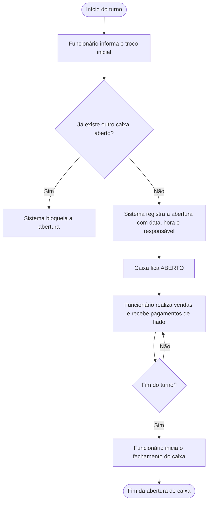
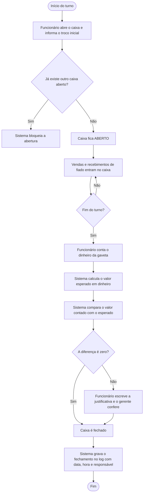
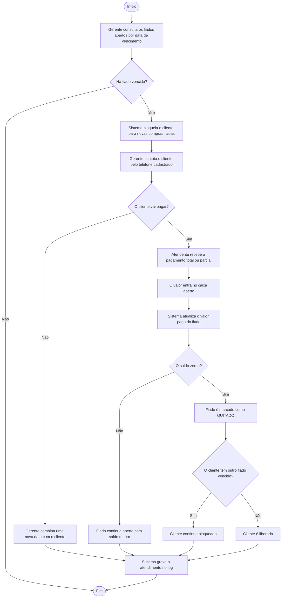
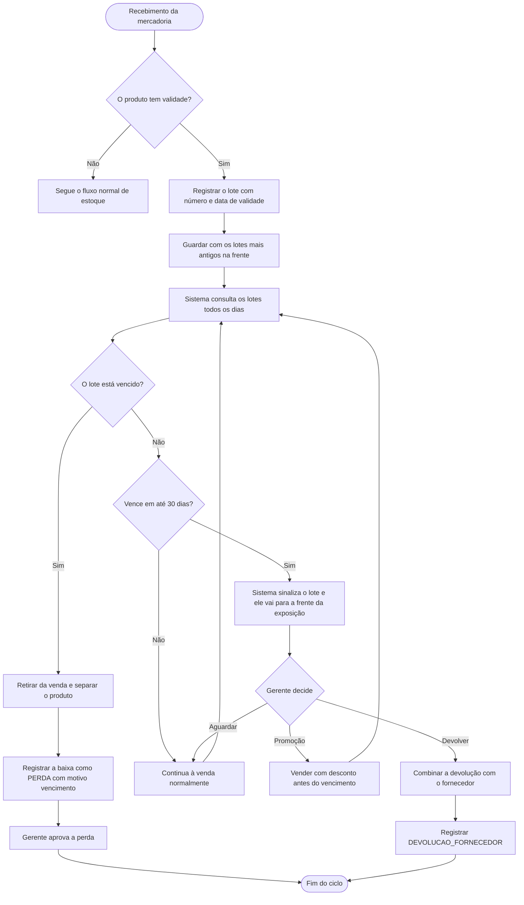
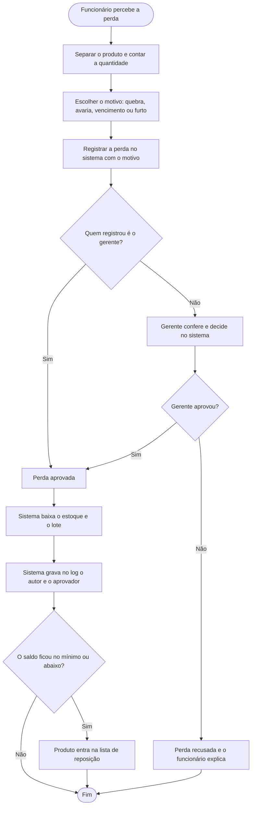
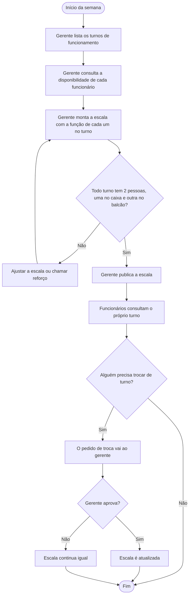

# Fluxogramas — processos que faltavam

Versão 1.0, 23/10/2026. Estes cinco processos **complementam** o arquivo `Fluxograma/Fluxograma.md` (que já tem os 10 primeiros). Cole o conteúdo no fim dele ou deixe como arquivo separado e cite no README.

Os diagramas são Mermaid: o GitHub desenha sozinho. Para exportar em imagem, cole o bloco em https://mermaid.live.

| # | Processo | Grupo | Regras | Entidades |
|---|---|---|---|---|
| 11 | Fechamento de caixa | Apoio | RN01, RN22, RN23, RN24 | CAIXA, VENDA, PAGAMENTO, PAGAMENTO_FIADO |
| 12 | Cobrança e quitação do fiado | Vendas | RN12, RN13 | FIADO, PAGAMENTO_FIADO, CLIENTE, CAIXA |
| 13 | Controle de validade | Apoio | RN17, RN15 | LOTE, MOVIMENTACAO_ESTOQUE |
| 14 | Perdas e quebras | Apoio | RN14, RN15 | MOVIMENTACAO_ESTOQUE, ESTOQUE, LOTE, LOG_ACESSO |
| 15 | Escala dos funcionários | Apoio | RN25 | ESCALA, FUNCIONARIO |

16 de 16 processos

reefaça , coloque a abertura do caixa

---

## 10. Abertura de caixa

**Quem participa:** funcionário responsável pelo caixa. O sistema verifica se já existe outro caixa aberto e registra o valor inicial em dinheiro.

**Valor inicial:** dinheiro disponível na gaveta no início do turno, utilizado como troco para as operações do caixa.

O sistema deve registrar o valor inicial, a data, o horário e o funcionário responsável pela abertura. O caixa permanece aberto até que o funcionário realize o processo de fechamento.

**Observação:** o bloqueio de uma segunda abertura simultânea deve ser confirmado pelo grupo como regra do sistema proposto, pois essa condição ainda precisa ser validada para a rotina da adega.
## 11. Fechamento de caixa

Quem participa: funcionário do caixa e gerente. O sistema calcula o dinheiro esperado e a diferença.

Valor esperado = troco inicial + dinheiro das vendas do caixa + dinheiro de fiado recebido no caixa. Sangrias (retirada de dinheiro) entram na observação do caixa.

---

## 12. Cobrança e quitação do fiado

Quem participa: gerente (cobrança), atendente (recebimento) e cliente.

---

## 13. Controle de validade

Quem participa: funcionário que recebe a mercadoria, gerente e sistema (consulta diária).

Na venda, vale a regra do primeiro que vence, primeiro que sai (RN17).

---

## 14. Perdas e quebras

Quem participa: qualquer funcionário (registra) e gerente (aprova).

---

## 15. Escala dos funcionários

Quem participa: gerente e os 3 a 4 funcionários da adega.

