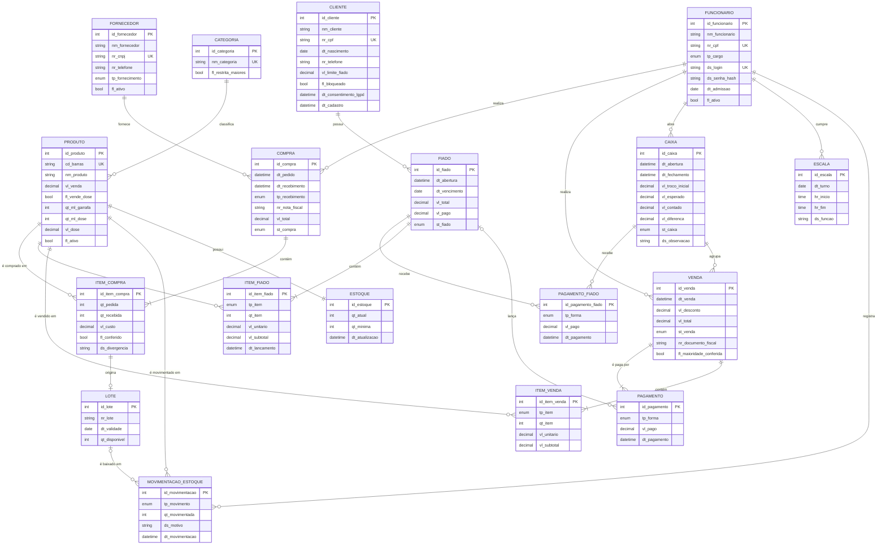

# DER da Adega (modelo conceitual)

Versão 1.0, 23/10/2026. Este arquivo substitui `DER.adega.png` e `Modelagem/DER_Adega.png`.

O diagrama abaixo é desenhado pelo próprio GitHub (Mermaid), então não depende de imagem externa. Para exportar em PNG ou PDF, cole o bloco em https://mermaid.live. O modelo lógico, com chaves estrangeiras, está em `modelo_logico.dbml` (abrir em https://dbdiagram.io/d) e em `script_adega.sql`.

## Como ler o diagrama

- O DER usa a notação pé de galinha. Cada ponta do traço mostra **mínimo e máximo**: `||` exatamente um, `|o` zero ou um, `}o` zero ou muitos, `}|` um ou muitos.
- O símbolo ao lado de uma entidade diz **quantas ocorrências dela** se ligam a uma ocorrência da outra. Ex.: `CATEGORIA ||--o{ PRODUTO` significa que cada produto tem exatamente 1 categoria e cada categoria tem 0 a N produtos.
- **Não há chaves estrangeiras** no desenho: elas só aparecem no modelo lógico. Cada entidade marca seu identificador (`PK`) e os atributos únicos (`UK`).
- `LOG_ACESSO` é tabela de apoio (auditoria) e fica fora do DER conceitual.

## Diagrama

## Relacionamentos com cardinalidade mínima e máxima

Notação (mín,máx) ao lado de cada entidade: quantas vezes uma ocorrência dela participa do relacionamento.

| # | Entidade A | (mín,máx) A | Relacionamento | (mín,máx) B | Entidade B | Chave estrangeira no modelo lógico |
|---|---|---|---|---|---|---|
| 1 | CATEGORIA | (0,N) | classifica | (1,1) | PRODUTO | `produto.id_categoria` |
| 2 | PRODUTO | (1,1) | possui | (1,1) | ESTOQUE | `estoque.id_produto (UNIQUE)` |
| 3 | PRODUTO | (0,N) | é movimentado em | (1,1) | MOVIMENTACAO_ESTOQUE | `movimentacao_estoque.id_produto` |
| 4 | FUNCIONARIO | (0,N) | registra | (1,1) | MOVIMENTACAO_ESTOQUE | `movimentacao_estoque.id_funcionario` |
| 5 | LOTE | (0,N) | é baixado em | (0,1) | MOVIMENTACAO_ESTOQUE | `movimentacao_estoque.id_lote` |
| 6 | ITEM_COMPRA | (0,1) | origina | (1,1) | LOTE | `lote.id_item_compra (UNIQUE)` |
| 7 | FUNCIONARIO | (0,N) | cumpre | (1,1) | ESCALA | `escala.id_funcionario` |
| 8 | FUNCIONARIO | (0,N) | abre | (1,1) | CAIXA | `caixa.id_funcionario` |
| 9 | FUNCIONARIO | (0,N) | realiza | (1,1) | VENDA | `venda.id_funcionario` |
| 10 | CAIXA | (0,N) | agrupa | (1,1) | VENDA | `venda.id_caixa` |
| 11 | VENDA | (1,N) | contém | (1,1) | ITEM_VENDA | `item_venda.id_venda` |
| 12 | PRODUTO | (0,N) | é vendido em | (1,1) | ITEM_VENDA | `item_venda.id_produto` |
| 13 | VENDA | (1,N) | é paga por | (1,1) | PAGAMENTO | `pagamento.id_venda` |
| 14 | FIADO | (0,N) | lança | (0,1) | PAGAMENTO | `pagamento.id_fiado` |
| 15 | CLIENTE | (0,N) | possui | (1,1) | FIADO | `fiado.id_cliente` |
| 16 | FIADO | (1,N) | contém | (1,1) | ITEM_FIADO | `item_fiado.id_fiado` |
| 17 | PRODUTO | (0,N) | é lançado em | (1,1) | ITEM_FIADO | `item_fiado.id_produto` |
| 18 | FIADO | (0,N) | recebe | (1,1) | PAGAMENTO_FIADO | `pagamento_fiado.id_fiado` |
| 19 | CAIXA | (0,N) | recebe | (1,1) | PAGAMENTO_FIADO | `pagamento_fiado.id_caixa` |
| 20 | FORNECEDOR | (0,N) | fornece | (1,1) | COMPRA | `compra.id_fornecedor` |
| 21 | FUNCIONARIO | (0,N) | realiza | (1,1) | COMPRA | `compra.id_funcionario` |
| 22 | COMPRA | (1,N) | contém | (1,1) | ITEM_COMPRA | `item_compra.id_compra` |
| 23 | PRODUTO | (0,N) | é comprado em | (1,1) | ITEM_COMPRA | `item_compra.id_produto` |

## O que foi corrigido em relação ao DER anterior

- **Cardinalidade mínima e máxima** em todos os 23 relacionamentos (antes só havia 1 e N).
- **Sem chaves estrangeiras** no modelo conceitual, e **identificador (PK) marcado** em todas as entidades.
- **ESTOQUE** agora liga a **PRODUTO** (1:1), não a VENDA. A venda reduz o estoque por meio de ITEM_VENDA e MOVIMENTACAO_ESTOQUE, como a justificativa técnica já defendia.
- **VENDA e PAGAMENTO** têm **um só** relacionamento (1 venda tem 1 a N pagamentos, o que cobre o pagamento dividido).
- **FUNCIONARIO** passou a ligar a **COMPRA** e a **MOVIMENTACAO_ESTOQUE**, que já tinham `id_funcionario`.
- Entidades desejáveis incluídas: **CAIXA** (abertura e fechamento), **LOTE** (validade) e **ESCALA** (turnos).
- **PAGAMENTO** recebeu ligação opcional com **FIADO**, para registrar em qual conta a venda fiada foi lançada.
- Modelo desenhado em Mermaid (texto), sem aparência de imagem gerada, e versionado junto do código.

## Entidades e atributos (conceitual)

### CATEGORIA

Agrupa os produtos da adega e define se a venda é restrita a maiores de 18 anos.

| Atributo | Descrição | Identificador |
|---|---|---|
| id_categoria | Identificador da categoria | PK |
| nm_categoria | Nome da categoria | único |
| fl_restrita_maiores | Indica se os produtos da categoria só podem ser vendidos a maiores de 18 anos |  |

### PRODUTO

Item comercializado: bebida, cigarro, petisco ou conveniência. Pode ser vendido fechado (unidade) ou em doses.

| Atributo | Descrição | Identificador |
|---|---|---|
| id_produto | Identificador do produto | PK |
| cd_barras | Código de barras (EAN-8, EAN-13 ou EAN-14) lido no balcão | único |
| nm_produto | Nome comercial com a medida |  |
| vl_venda | Preço de venda da unidade fechada |  |
| fl_vende_dose | Indica se o produto também é vendido em doses |  |
| qt_ml_garrafa | Volume da garrafa em mililitros |  |
| qt_ml_dose | Volume de uma dose em mililitros |  |
| vl_dose | Preço de uma dose |  |
| fl_ativo | Indica se o produto está ativo para venda |  |

### ESTOQUE

Saldo atual de cada produto (relação 1:1 com PRODUTO). Só muda por meio de MOVIMENTACAO_ESTOQUE.

| Atributo | Descrição | Identificador |
|---|---|---|
| id_estoque | Identificador do registro de estoque | PK |
| qt_atual | Quantidade atual em unidades |  |
| qt_minima | Quantidade mínima antes de repor (ponto de reposição) |  |
| dt_atualizacao | Data e hora da última alteração do saldo |  |

### FUNCIONARIO

Pessoa da equipe (3 a 4 funcionários) que usa o sistema. Perfis: atendente e gerente.

| Atributo | Descrição | Identificador |
|---|---|---|
| id_funcionario | Identificador do funcionário | PK |
| nm_funcionario | Nome completo |  |
| nr_cpf | CPF do funcionário (dado pessoal, LGPD) | único |
| tp_cargo | Perfil de acesso no sistema |  |
| ds_login | Nome de usuário para entrar no sistema | único |
| ds_senha_hash | Hash da senha (bcrypt ou argon2) |  |
| dt_admissao | Data de entrada na adega |  |
| fl_ativo | Indica se o funcionário ainda atua |  |

### ESCALA

Turno de trabalho de um funcionário em um dia, com a função que ele exerce.

| Atributo | Descrição | Identificador |
|---|---|---|
| id_escala | Identificador do turno | PK |
| dt_turno | Dia do turno |  |
| hr_inicio | Hora de início |  |
| hr_fim | Hora de término |  |
| ds_funcao | Função exercida no turno |  |

### CLIENTE

Cliente cadastrado para comprar fiado. Reúne dados pessoais protegidos pela LGPD.

| Atributo | Descrição | Identificador |
|---|---|---|
| id_cliente | Identificador do cliente | PK |
| nm_cliente | Nome completo |  |
| nr_cpf | CPF do cliente (dado pessoal, LGPD) | único |
| dt_nascimento | Data de nascimento, para comprovar maioridade |  |
| nr_telefone | Telefone com DDD, para cobrança |  |
| vl_limite_fiado | Limite de saldo devedor autorizado |  |
| fl_bloqueado | Indica se o cliente está impedido de comprar fiado |  |
| dt_consentimento_lgpd | Momento em que o cliente consentiu o uso dos dados |  |
| dt_cadastro | Data e hora do cadastro |  |

### CAIXA

Sessão de caixa, da abertura ao fechamento, com a conferência do dinheiro.

| Atributo | Descrição | Identificador |
|---|---|---|
| id_caixa | Identificador da sessão de caixa | PK |
| dt_abertura | Data e hora de abertura |  |
| dt_fechamento | Data e hora de fechamento |  |
| vl_troco_inicial | Dinheiro de troco colocado na abertura |  |
| vl_esperado | Dinheiro que deveria estar na gaveta no fechamento |  |
| vl_contado | Dinheiro contado fisicamente no fechamento |  |
| vl_diferenca | Diferença entre o contado e o esperado |  |
| st_caixa | Situação da sessão |  |
| ds_observacao | Justificativa da diferença e registro de sangrias |  |

### VENDA

Venda feita no balcão, ligada ao funcionário e ao caixa aberto.

| Atributo | Descrição | Identificador |
|---|---|---|
| id_venda | Identificador da venda | PK |
| dt_venda | Data e hora da venda |  |
| vl_desconto | Desconto concedido na venda |  |
| vl_total | Valor total cobrado |  |
| st_venda | Situação da venda |  |
| nr_documento_fiscal | Chave de acesso da NFC-e ou número do cupom fiscal |  |
| fl_maioridade_conferida | Indica que o atendente conferiu a maioridade do comprador |  |

### FIADO

Conta de fiado aberta para um cliente, com prazo e saldo.

| Atributo | Descrição | Identificador |
|---|---|---|
| id_fiado | Identificador do fiado | PK |
| dt_abertura | Data e hora de abertura da conta |  |
| dt_vencimento | Data limite para pagamento |  |
| vl_total | Total lançado na conta |  |
| vl_pago | Total já pago |  |
| st_fiado | Situação da conta |  |

### ITEM_VENDA

Produto vendido em uma venda, com quantidade e preço do momento.

| Atributo | Descrição | Identificador |
|---|---|---|
| id_item_venda | Identificador do item da venda | PK |
| tp_item | Indica se foi vendida a unidade fechada ou uma dose |  |
| qt_item | Quantidade vendida |  |
| vl_unitario | Preço unitário no momento da venda |  |
| vl_subtotal | Valor do item |  |

### PAGAMENTO

Forma de pagamento de uma venda. Uma venda pode ter vários pagamentos (pagamento dividido).

| Atributo | Descrição | Identificador |
|---|---|---|
| id_pagamento | Identificador do pagamento | PK |
| tp_forma | Forma de pagamento |  |
| vl_pago | Valor pago nesta forma |  |
| dt_pagamento | Data e hora do pagamento |  |

### ITEM_FIADO

Produto lançado em um fiado, com quantidade e preço do momento.

| Atributo | Descrição | Identificador |
|---|---|---|
| id_item_fiado | Identificador do item do fiado | PK |
| tp_item | Unidade fechada ou dose |  |
| qt_item | Quantidade lançada |  |
| vl_unitario | Preço unitário no momento do lançamento |  |
| vl_subtotal | Valor do item |  |
| dt_lancamento | Data e hora do lançamento |  |

### PAGAMENTO_FIADO

Pagamento (total ou parcial) recebido para abater um fiado.

| Atributo | Descrição | Identificador |
|---|---|---|
| id_pagamento_fiado | Identificador do pagamento do fiado | PK |
| tp_forma | Forma usada para quitar |  |
| vl_pago | Valor recebido |  |
| dt_pagamento | Data e hora do recebimento |  |

### FORNECEDOR

Empresa que vende mercadoria para a adega, com entrega ou retirada.

| Atributo | Descrição | Identificador |
|---|---|---|
| id_fornecedor | Identificador do fornecedor | PK |
| nm_fornecedor | Razão social ou nome fantasia |  |
| nr_cnpj | CNPJ do fornecedor | único |
| nr_telefone | Telefone de contato com DDD |  |
| tp_fornecimento | Como o fornecedor costuma atender |  |
| fl_ativo | Indica se o fornecedor está ativo |  |

### COMPRA

Pedido de compra feito a um fornecedor por um funcionário.

| Atributo | Descrição | Identificador |
|---|---|---|
| id_compra | Identificador da compra | PK |
| dt_pedido | Data e hora do pedido |  |
| dt_recebimento | Data e hora do recebimento |  |
| tp_recebimento | Como a mercadoria chegou |  |
| nr_nota_fiscal | Número ou chave da nota fiscal do fornecedor |  |
| vl_total | Valor total do pedido |  |
| st_compra | Situação da compra |  |

### ITEM_COMPRA

Produto pedido em uma compra, com quantidade pedida, recebida e conferência.

| Atributo | Descrição | Identificador |
|---|---|---|
| id_item_compra | Identificador do item da compra | PK |
| qt_pedida | Quantidade pedida ao fornecedor |  |
| qt_recebida | Quantidade realmente recebida |  |
| vl_custo | Custo unitário pago ao fornecedor |  |
| fl_conferido | Indica que o item foi conferido no recebimento |  |
| ds_divergencia | Descrição de erro, falta ou avaria |  |

### LOTE

Lote recebido de produto com validade. Permite controlar vencimento e vender primeiro o que vence antes.

| Atributo | Descrição | Identificador |
|---|---|---|
| id_lote | Identificador do lote | PK |
| nr_lote | Número do lote impresso na embalagem |  |
| dt_validade | Data de validade do lote |  |
| qt_disponivel | Quantidade ainda disponível no lote |  |

### MOVIMENTACAO_ESTOQUE

Histórico de toda entrada e saída de estoque. Não pode ser alterado nem excluído.

| Atributo | Descrição | Identificador |
|---|---|---|
| id_movimentacao | Identificador da movimentação | PK |
| tp_movimento | Tipo da movimentação |  |
| qt_movimentada | Quantidade movimentada, sempre positiva |  |
| ds_motivo | Motivo da movimentação |  |
| dt_movimentacao | Data e hora da movimentação |  |

